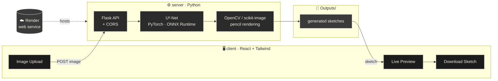
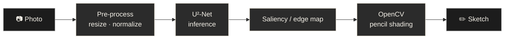
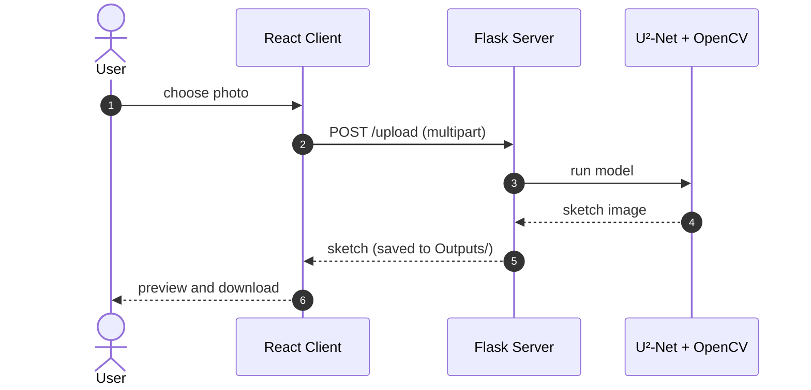

<div align="center">


<br/>


**Upload a photo. Get back a hand-drawn look.**
An AI-powered image-to-pencil-sketch web app, built on U²-Net.

[](https://gitdiagram.com/shiv0xparanoid/sketchify)

[About](#-about) · [Workflow](#-workflow) · [Tech Stack](#-tech-stack) · [Structure](#-project-structure) · [Run Locally](#-run-locally) · [Deploy](#-deploy)

</div>

<br/>

## ✦ About

Sketchify takes an ordinary photo and redraws it as a pencil sketch. A React frontend handles the upload and preview, and a Python backend runs the deep-learning pipeline built around **U²-Net**, then returns the finished sketch to the browser.

<!--
Add a before/after pair here once you have one:

| Photo | Sketch |
|---|---|
|  |  |
-->

<br/>

## ✦ Workflow

> 🔍 **Interactive version:** open this repo on **[GitDiagram](https://gitdiagram.com/shiv0xparanoid/sketchify)** for the auto-generated, clickable architecture view. (Replace `github.com` with `gitdiagram.com` in any repo URL.) The diagrams below are the curated versions.

### 1 · System architecture



### 2 · Photo → sketch pipeline



### 3 · Request flow



<br/>

## ✦ Tech Stack

| Layer | Tools |
|---|---|
| **Frontend** | React (Create React App) · Tailwind CSS · PostCSS |
| **Backend** | Python · Flask · Flask-CORS |
| **Model** | U²-Net · PyTorch · ONNX Runtime |
| **Image processing** | OpenCV · scikit-image · Pillow · rembg |
| **Hosting** | Render |

<br/>

## ✦ Project Structure

```
sketchify/
├── client/            # React frontend
├── src/ · public/     # React app source and static assets
├── server/            # Python backend API
├── U-2-Net/           # U²-Net model code
├── Outputs/           # generated sketches
├── static/
├── test_upload.py     # quick upload test against the API
├── requirements.txt   # Python dependencies
├── render.yaml        # Render deployment config
└── package.json
```

<br/>

## ✦ Run Locally

> **Needs:** Node 18+, Python 3.10+. A GPU is optional, since the model also runs on CPU.

```bash
git clone https://github.com/shiv0xparanoid/sketchify.git
cd sketchify
```

**Backend**

```bash
python -m venv .venv
source .venv/bin/activate        # Windows: .venv\Scripts\activate
pip install -r requirements.txt
cd server && python app.py
```

**Frontend** (new terminal)

```bash
npm install
npm start                        # http://localhost:3000
```

The frontend reads the API address from `.env.development`. Point it at your local server when developing.

> 💡 U²-Net needs its pretrained weights. If they aren't in the repo, download them into `U-2-Net/` before the first run.

**Test the API without the UI**

```bash
python test_upload.py
```

<br/>

## ✦ Deploy

The backend is set up as a **Render** web service via `render.yaml` (build: `pip install -r requirements.txt`). Set the production API URL in `.env.production` so the frontend talks to the deployed backend.

<br/>

## ✦ Roadmap

- [ ] Sketch style presets (soft pencil, charcoal, ink line)
- [ ] Adjustable stroke and shading intensity
- [ ] Batch upload
- [ ] Before/after slider in the preview

<br/>

<div align="center">

Built by **[Shivang](https://github.com/shiv0xparanoid)**

<sub>If Sketchify turned your selfie into art, drop a ⭐</sub>


</div>
